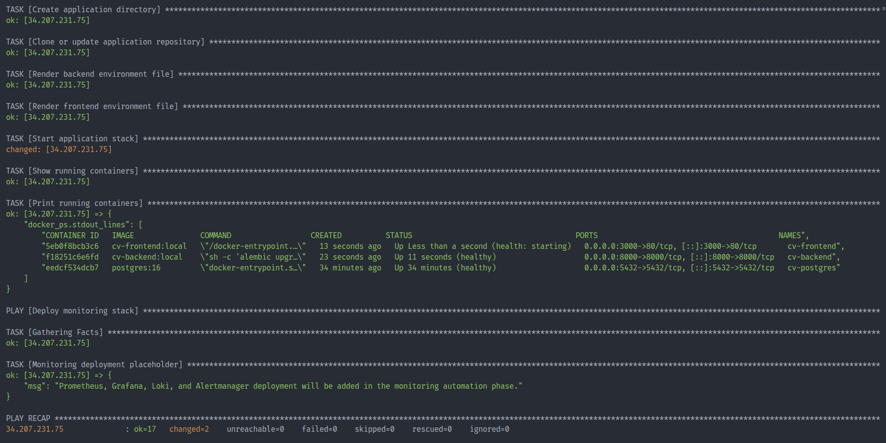
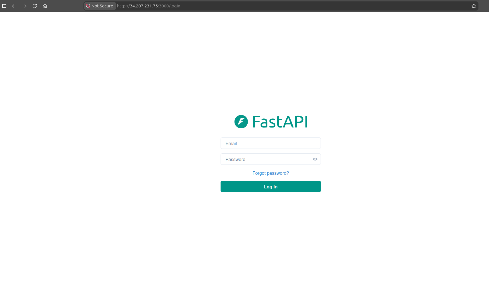
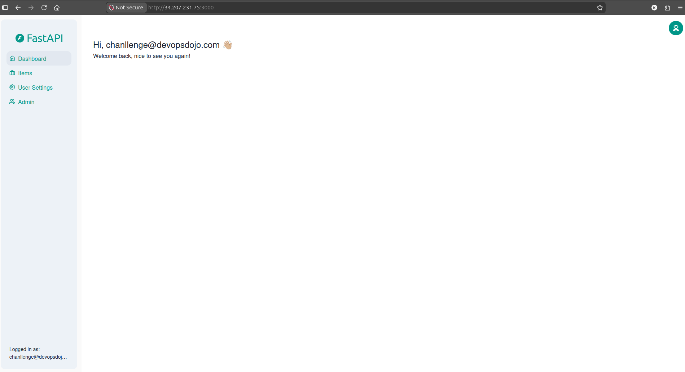

# Ansible Validation

## Objective

Configure the provisioned EC2 instance and deploy the application stack automatically.

---

## Playbooks Executed

### Install Docker

Responsibilities:

- Install Docker Engine
- Install Docker Compose Plugin
- Enable Docker service
- Configure Docker group permissions

---

### Deploy Application

Responsibilities:

- Clone application repository
- Generate backend environment file
- Generate frontend environment file
- Deploy application stack using Docker Compose

---

## Playbook Execution

```bash
ansible-playbook -i inventory.ini ansible/playbooks/site.yml
```

Result:

- Playbook completed successfully
- No failed tasks

---

## Validation Evidence

### Ansible Playbook Success



---

### Running Containers


---

### Backend Swagger UI


---

### Frontend Login



---

### Frontend Dashboard



---

## Container Status

Application stack:

- Frontend (React + Nginx)
- Backend (FastAPI)
- PostgreSQL

All containers healthy.

---

## Application Validation

### Frontend

Accessible via:

```text
http://34.207.231.75:3000
```

---

### Backend

Accessible via:

```text
http://34.207.231.75:8000/docs
```

---

### Login Credentials

Application administrator credentials are supplied securely at deployment time.

**Required environment variables:**

- `POSTGRES_PASSWORD`
- `FIRST_SUPERUSER_PASSWORD`

Passwords must be supplied through the Ansible execution environment.

For production deployments, use AWS Secrets Manager or another centralized secrets management solution.

Never commit actual passwords, API keys, or other sensitive credentials to Git.

## Result

Ansible successfully configured the EC2 instance and deployed the complete application stack automatically.
