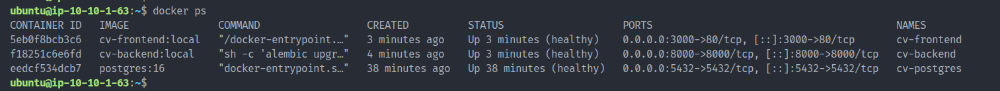
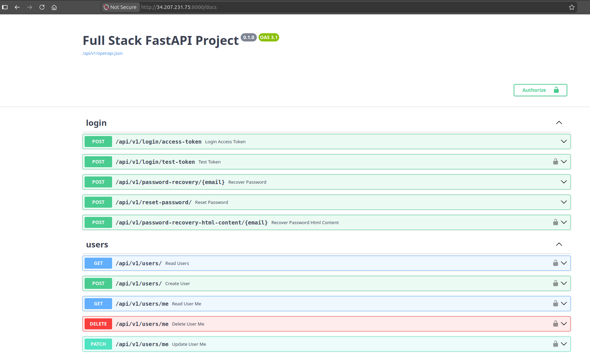

# Ansible Validation — EC2 Application Deployment

> **Evidence scope:** This document preserves earlier successful Ansible deployment evidence for the **EC2 + Docker Compose** path. The separate EKS/Traefik/PostgreSQL PVC architecture is not deployed by this Ansible workflow. Historical screenshots and IP addresses are not proof of a currently running environment.

## Objective

Configure a Terraform-provisioned EC2 instance and deploy the application stack with Ansible.

The EC2 application stack consists of:

- React/Vite frontend served by Nginx
- FastAPI backend
- PostgreSQL database
- Docker Engine and Docker Compose

---

## Playbook Responsibilities

### Install Docker

- Install Docker Engine
- Install the Docker Compose plugin
- Enable the Docker service
- Configure Docker group permissions as defined by the Ansible roles

### Deploy Application

- Clone the application repository
- Render deployment environment files on the target
- Supply backend/database configuration without committing secrets
- Start the application through Docker Compose

The actual tasks and variable names in `ansible/` are authoritative. Do not assume the EC2 `.env` templates are Kubernetes Secrets or that the frontend's Vite configuration can be changed after its image has been built.

---

## Execution Context

Terraform generates a dynamic inventory at the **infrastructure repository root** during the EC2 provisioning workflow. The repository also contains a separately maintained Ansible inventory for manual use.

From the infrastructure repository root, a manual playbook invocation can use the generated inventory:

```bash
cd ~/Projects/cloud-native-devops-platform-infra
ANSIBLE_CONFIG=ansible/ansible.cfg \
  ansible-playbook -i inventory.ini ansible/playbooks/site.yml
```

Only use `inventory.ini` if it exists and points to the intended current EC2 instance. Check its actual location and contents before running the command. The original bare command without the `ANSIBLE_CONFIG` setting may select a different Ansible configuration depending on the working directory and environment.

### Preconditions

1. Verify the AWS account/region and EC2 instance identity.
2. Verify that the SSH private key corresponds to the instance's configured public key; never commit the private key.
3. Independently verify and enroll the EC2 SSH host key in `known_hosts`. **Do not disable host-key checking to bypass this step.**
4. Supply `POSTGRES_PASSWORD` and `FIRST_SUPERUSER_PASSWORD` securely in the environment that runs Ansible. `FIRST_SUPERUSER_EMAIL` may be configured where supported (historical default: `admin@example.com`).
5. Confirm that network rules permit SSH from the approved administrator address and application traffic only as intended.

Terraform may invoke the playbook automatically through a `local-exec` provisioner. During a fresh unattended deployment, the host-key trust prerequisite must be satisfied before that first connection; otherwise the apply's provisioning step may fail even if EC2 creation succeeded.

---

## Historical Playbook Execution

**Historical outcome:** The playbook completed successfully without failed tasks. The historical record did not preserve a full terminal transcript, so this document does not invent task counts or execution timing.

## Historical Validation Evidence

### Ansible Playbook Success


### Running Containers



### Backend Swagger UI



### Frontend Login


### Frontend Dashboard


The screenshot paths above use the filenames currently listed under this repository's `docs/screenshots/` directory.

## Application Validation

The historical EC2 deployment exposed the following example endpoints:

| Service | Historical example |
| --- | --- |
| Frontend | `http://34.207.231.75:3000` |
| Backend Swagger UI | `http://34.207.231.75:8000/docs` |

These endpoints were observed for an earlier deployment and should **not** be assumed reachable or assigned to the same EC2 instance today.

**Historical result:** Frontend, backend and PostgreSQL containers were reported healthy. The login page, dashboard and Swagger UI were tested and captured as screenshots.

## Secure Credentials

Required application credentials include:

- `POSTGRES_PASSWORD`
- `FIRST_SUPERUSER_PASSWORD`

Use deployment-time secret injection, a suitable password manager, or centralized secret management such as AWS Secrets Manager. Avoid printing passwords, writing them to documentation, placing them in committed `.env` files, or embedding them in Docker images.

The backend JWT `SECRET_KEY` must also be supplied securely for deployments that require it. Inspect the current application configuration for the complete required environment-variable set before running a fresh build.

## Future Rebuild Verification

For a fresh EC2 deployment, verify independently:

```bash
# On the EC2 host after Ansible has finished:
docker compose ps
```

The command above must be executed in the directory containing the deployed `docker-compose.yaml`. Check frontend/backend/database health, the backend's database connectivity, login/dashboard behavior and the Swagger UI. Record any newly observed results with the date and source revision.

---

## Result

**EC2 + Ansible historical deployment: VERIFIED by prior operational evidence.** The documented playbook configured the instance and deployed the application stack.

**November EKS changes: NOT COVERED by this EC2 Ansible validation.** Traefik, Kubernetes ClusterIP, PostgreSQL PVC and Amazon EBS CSI belong to the separate EKS deployment path and need their own runtime validation.

Related documents: [Terraform validation](terraform-validation.md) and the repository [README](../README.md).
