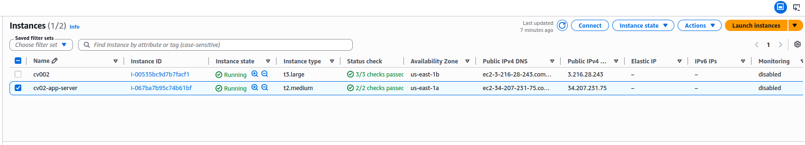

# Terraform Validation — EC2/Ansible Deployment

> **Evidence scope:** This document records the previously completed **EC2 + Ansible** infrastructure validation. It is not evidence that the separate EKS Terraform configuration, added EBS CSI driver, or PostgreSQL EBS persistence has been successfully deployed. Review the current source and generate a fresh plan before rebuilding.

## Objective

Provision the EC2 application infrastructure with Terraform and generate the dynamic Ansible inventory used to configure the instance.

The previously validated EC2 deployment included:

- VPC and public subnet
- Internet Gateway and route table
- Security Group
- EC2 instance
- Dynamic Ansible inventory and Terraform-to-Ansible invocation

The **Amazon EKS** Terraform configuration is a separate deployment path under `terraform/eks/`. Do not run the EC2 Terraform commands against the EKS directory by mistake.

---

## Execution Directory and Preconditions

Run the EC2-specific Terraform commands from the repository's `terraform/` directory:

```bash
cd ~/Projects/cloud-native-devops-platform-infra/terraform
```

Before deployment:

1. Verify the AWS account and region: `aws sts get-caller-identity` and `aws configure get region`.
2. Review `variables.tf`, the SSH key path, and the permitted administrator SSH CIDR.
3. Supply application credentials required by the Ansible execution environment securely; never place passwords in Git or a public Terraform plan.
4. Review the `local-exec` Ansible trigger. **Strict SSH host-key verification requires authenticated enrollment of the new EC2 host key before the first SSH connection.** A direct `terraform apply` may not finish its Ansible provisioner until this prerequisite is satisfied.
5. Ensure the Terraform state location is understood and secured; do not commit state or saved plans.

## Terraform Initialization

```bash
terraform init
```

**Historical result:** Provider download and backend initialization completed successfully for the EC2 deployment.

## Formatting and Configuration Validation

```bash
terraform fmt -check
terraform validate
```

Use these checks during any future rebuild. The original validation record did not capture their exact console output, so no historical result is claimed here.

## Terraform Plan

```bash
terraform plan
```

**Historical result:** Infrastructure changes were reviewed before deployment.

For a new rebuild, confirm the correct AWS identity, VPC and EC2 resources, Security Group ingress, SSH key and intended resource counts. Do not reuse an old saved plan.

## Terraform Apply

```bash
terraform apply
```

**Historical result:** The EC2 infrastructure and public instance were created successfully. Terraform was also configured to generate an Ansible inventory and invoke Ansible through `local-exec`.

> **Caution:** `terraform apply` is a potentially billable operation. The EC2 workflow may invoke Ansible automatically; it is not a Terraform-only dry run.

---

## Historical Validation Evidence

### EC2 Instance Created



### Terraform Apply Successful


The image paths above match the filenames present in this repository's `docs/screenshots/` inventory.

## Historical Outputs

Terraform generated operational output values including the public instance address, application URLs, and SSH connection information.

The following address is a **historical example**, not a current endpoint:

```text
app_public_ip    = 34.207.231.75
frontend_url     = http://34.207.231.75:3000
backend_docs_url = http://34.207.231.75:8000/docs
```

Get current values from the active Terraform state after a new apply; do not assume that the example IP remains assigned.

---

## November 2026 — Separate EKS Storage Infrastructure Update

The infrastructure repository also contains a separate EKS configuration under `terraform/eks/`. The November 9 source changes added `terraform/eks/ebs-csi.tf` to declare the EKS Pod Identity Agent, the IAM integration for the EBS CSI controller, and the Amazon EBS CSI add-on.

**Validation completed:** Terraform initialization without the backend, formatting, and `terraform validate` passed for the EKS source changes.

**Not yet validated:** EKS Terraform apply, add-on health, Pod Identity role assumption, EBS gp3 dynamic provisioning, PVC binding, PostgreSQL data persistence, and teardown of retained EBS volumes. There is no currently running Project 1 EKS cluster.

The Kubernetes repository owns the `postgres-pvc` and gp3 StorageClass manifests. `reclaimPolicy: Retain` can leave billable EBS volumes after PVC/PV or cluster teardown; retained resources must be audited and removed deliberately when no longer needed.

Do **not** treat the earlier EC2 apply screenshot as evidence of these newer EKS storage changes.

---

## Result

**Historical EC2 path: VERIFIED by the recorded deployment and screenshots.** Terraform provisioned the EC2 networking/compute layer and generated inventory information used by Ansible.

**November EKS/EBS CSI source: LOCALLY VALIDATED ONLY.** AWS runtime verification remains outstanding.

Related documents: [Ansible validation](ansible-validation.md) and the repository [README](../README.md).
