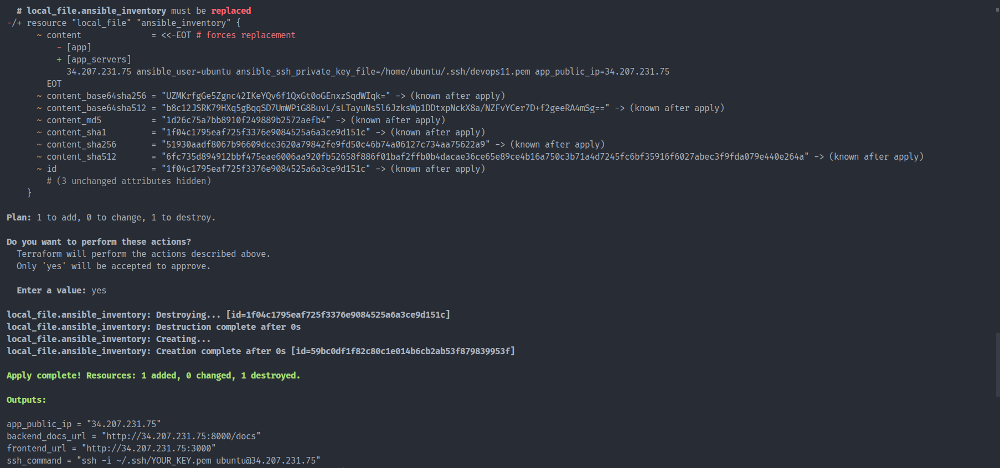

# Terraform Validation

## Objective

Provision AWS infrastructure automatically using Terraform.

Infrastructure created:

- VPC
- Public Subnet
- Internet Gateway
- Route Table
- Security Group
- EC2 Instance

---

## Terraform Initialization

```bash
terraform init
```

Result:

- Providers downloaded successfully
- Terraform backend initialized

---

## Terraform Plan

```bash
terraform plan
```

Result:

- Infrastructure changes reviewed before deployment

---

## Terraform Apply

```bash
terraform apply
```

Result:

- Infrastructure created successfully
- Public EC2 instance provisioned

---

## Validation Evidence

### EC2 Instance Created


---

### Terraform Apply Successful



---

## Outputs

Terraform generated:

- Public IP
- Frontend URL
- Backend URL
- SSH command

Example:

```text
app_public_ip = 34.207.231.75
frontend_url = http://34.207.231.75:3000
backend_docs_url = http://34.207.231.75:8000/docs
```

---

## Result

Terraform successfully provisioned cloud infrastructure and generated inventory information for Ansible automation.
